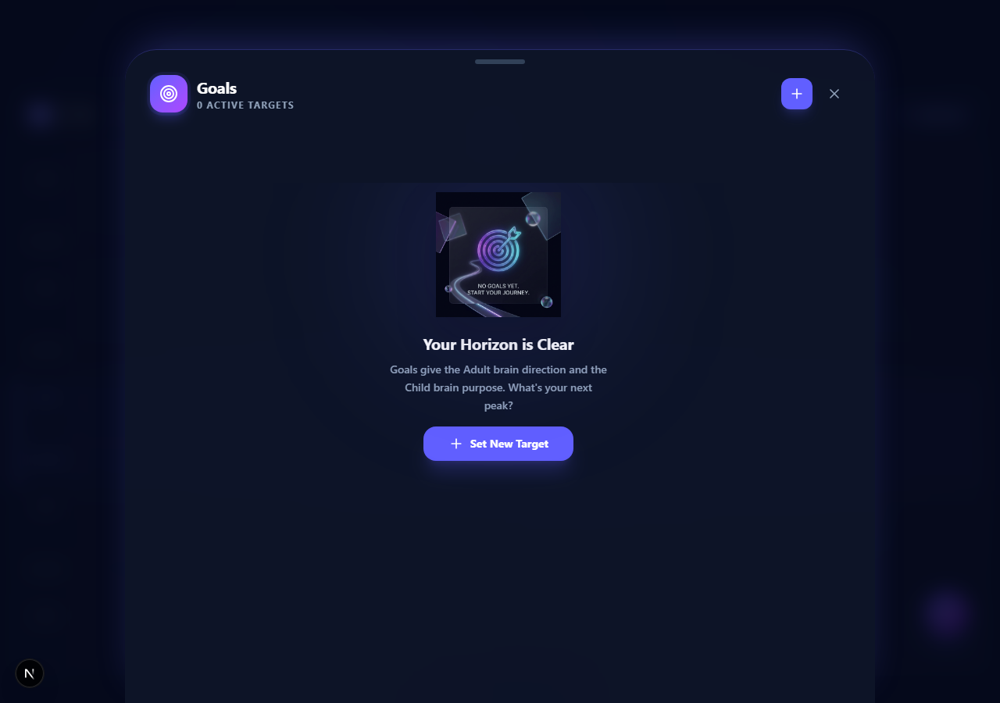
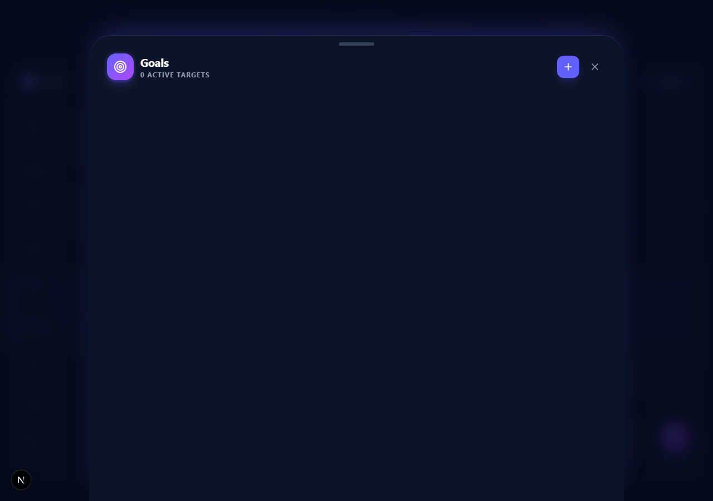
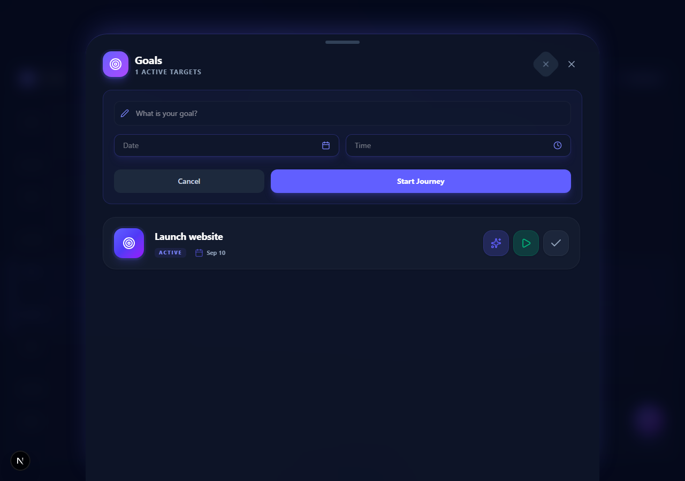
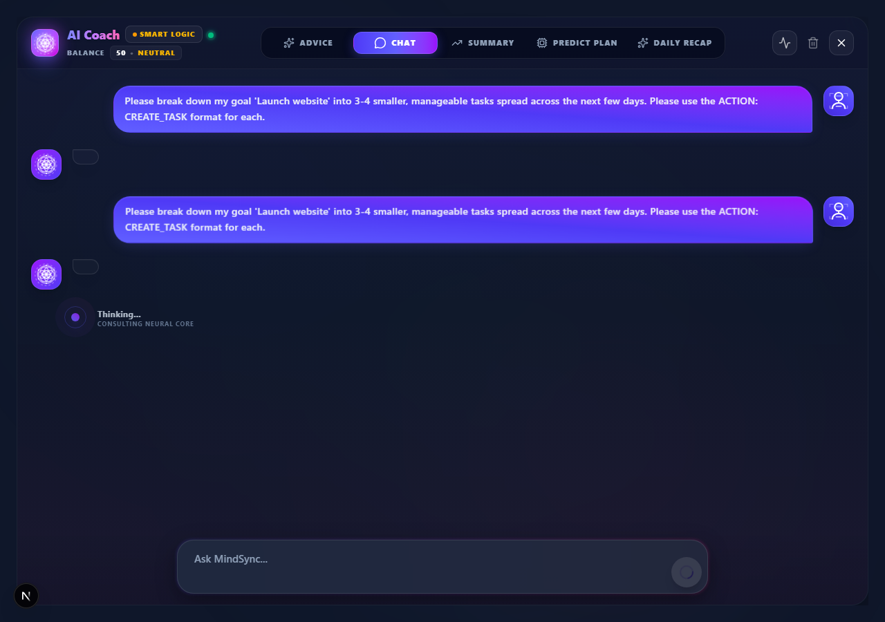
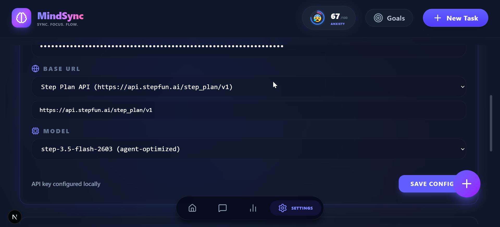
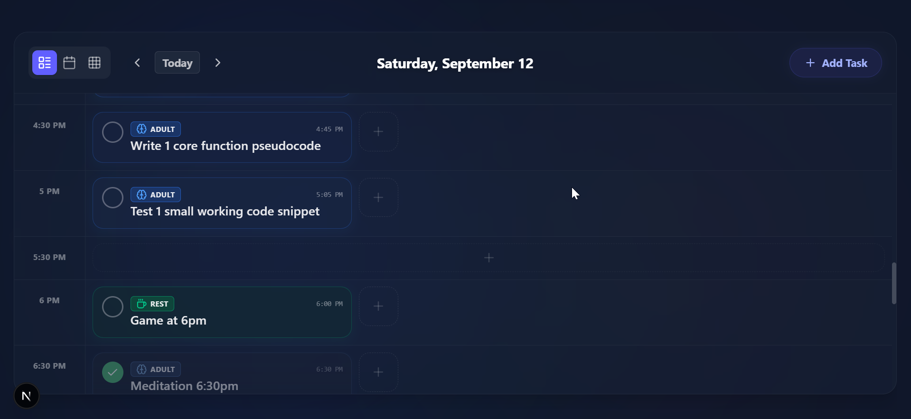
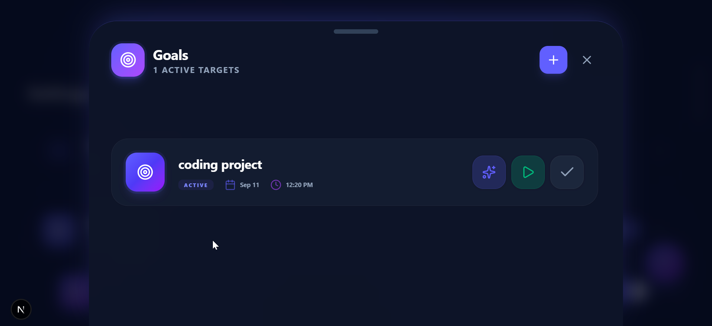
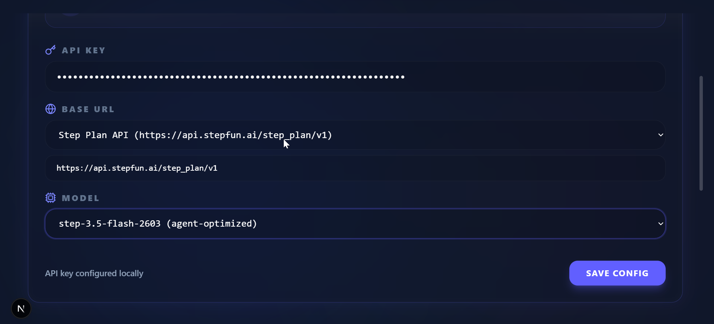

# MindSync

**Status:** ✅ Production Ready  
**Stack:** Next.js 16 + TypeScript + Tailwind CSS + Zustand  
**Data:** Browser-local by default (`localStorage`) — optional opt-in sync via your own PocketBase; no third-party accounts  
**AI:** Provider-agnostic Coach with online/offline fallback

---

## What Is MindSync?

MindSync is a second-brain psychological task management system. It balances **Adult** work, **Child** play, and **Rest** recovery so you can schedule realistically instead of overloading one mode.

Unlike ordinary todo apps, it doesn’t just track tasks. It classifies them, schedules them across days, scores daily balance, and uses an AI Coach to turn vague goals into executable action blocks.

---

## Screenshots

| Goals Panel | Add Goal | Goal Created | AI Breakdown |
|-------------|---------|--------------|--------------|
|  |  |  |  |

| AI Coach Chat | Timeline | Kanban | Settings |
|---------------|----------|--------|----------|
|  |  |  |  |

---

## Features

| Feature | Status |
|---------|--------|
| Timeline scheduling | ✅ |
| Kanban board (TODO / START / DONE) | ✅ |
| AI Coach — online mode | ✅ |
| AI Coach — offline / Smart Logic | ✅ |
| Natural language scheduling | ✅ |
| Explicit-date scheduling | ✅ |
| Goals + AI breakdown / start | ✅ |
| Daily balance scoring | ✅ |
| Dark mode / responsive | ✅ |
| Import / export JSON | ✅ |
| No cloud lock-in | ✅ |

---

## Quick Start

```bash
# install
npm install

# dev
npm run dev
# → http://localhost:3000

# build
npm run build
```

### Environment

Create `.env.local` in the project root:

```env
AI_PROVIDER=stepfun
STEPFUN_API_KEY=your_stepfun_key_here
STEPFUN_API_URL=https://api.stepfun.ai/step_plan/v1
```

> If no key is present, the Coach automatically falls back to offline Smart Logic. No hardcoded keys are included in the repo.

---

## Run It Locally (Docker — recommended)

The whole stack (app + sync server) runs on your own machine:

```bash
docker compose up --build
# app ......... http://localhost:3000
# PocketBase .. http://localhost:8090  (admin UI at http://localhost:8090/_/)
```

That's it. Your data lives in `./pb_data` (a single SQLite-backed folder — copy it to back up, mount it anywhere).

**Without Docker** (plain Node):

```bash
npm ci
npm run build
npm start          # http://localhost:3000
```

For the sync server without Docker, download the PocketBase binary from
https://pocketbase.io and run `./pocketbase serve` (data lands in `./pb_data`).

---

## Cross-Device Sync (optional)

MindSync is **local-first**: every task, goal, and preference is saved in the
browser's `localStorage` immediately, so the app works fully offline. Sync is
opt-in and reconciles that local cache with your PocketBase account:

- **PocketBase** (MIT, single binary) is the merge point — accounts, API, storage in one.
- Edits push/pull on **Sync now** and automatically on app load when signed in.
- Conflicts resolve **last-write-wins per record** (`updatedAt` timestamp).
- Deletions propagate via tombstones (and the record is removed server-side).
- Your **AI API key never syncs** — it stays on the device it was entered on.
- Want your phone to sync from home? The app talks to PocketBase through its own
  origin (`/pb` proxy, see `next.config.ts` rewrites), so **no per-device URL setup is
  needed** — reach the *app* from your phone (same Wi-Fi, or put the PC on **Tailscale**
  and open `http://<pc-tailscale-ip>:3000`) and sync just works. This also keeps the
  page's CSP (`connect-src 'self'`) satisfied.
- Advanced: the Settings → Data Lab URL field can point the app at a direct PocketBase
  address (e.g. `http://127.0.0.1:8090`). Direct cross-origin addresses are outside the
  CSP allowlist (browser blocks them) and may be cached by the service worker — the
  same-origin `/pb` path is the supported configuration.
- **Erase All Data** is sync-aware: it tombstones every record (so other devices and the
  server forget it too) and signs you out before wiping, so the next sync can't resurrect
  erased data. If you erase while offline, the tombstones stay queued and flush on your
  next sync.
- Known limitation: daily snapshots are keyed by the device's local date, so devices
  in different timezones write separate snapshot rows for the same day.

**One-time setup** (creates the sync schema; safe to re-run):

```bash
# 1. PocketBase running (compose up, or ./pocketbase serve)
# 2. create the collections (uses your PocketBase superuser login)
node tools/pb-setup.mjs --email admin@example.com --password your-password
# 3. create your app user in the PocketBase admin UI (users collection, email+password)
# 4. in the app: Settings -> Data Lab -> Cloud Sync -> sign in
```

**Verify the sync layer end-to-end** (needs a running PocketBase + the test user):

```bash
PB_ADMIN_EMAIL=admin@example.com PB_ADMIN_PASSWORD=your-password \
TEST_EMAIL=you@email.com TEST_PASSWORD=your-password \
npx tsx tools/sync-smoke-test.ts
```

---

## How It Works

### 1. Create Tasks
- **Timeline / Kanban:** use the built-in form.
- **AI Coach:** type natural language like:
  - `"Schedule meditation on 2026-09-09 at 8pm for 30 minutes"`
  - `"Add a 1-hour workout on 2026-09-10 at 6am"`

### 2. Classify by Brain Mode
Every task is typed:
- **ADULT** — work, focus, responsibility
- **CHILD** — play, creativity, fun
- **REST** — recovery, breaks, vegetative reset

The app tracks daily ratios and warns when a day is unbalanced.

### 3. Use AI Coach
- **Online mode** uses your configured API key.
- **Offline mode** uses built-in Smart Logic and still creates tasks with date, time, and duration.
- Responses include action blocks:
  - **Add to Timeline** — create the suggested task
  - **Suggest Another** — regenerate the suggestion
  - **Mental Note** — save context

### 4. Set Goals
- Create a goal with a target date.
- Click **Breakdown with AI** to split it into 3–4 starter tasks.
- Click **Start** to get an immediate starter plan.
- Click the checkmark to mark complete.

### 5. Schedule on Calendar
- Tasks appear on the timeline by hour for the selected date.
- Coach-created tasks include explicit `scheduledDate` and `scheduledTime`.

---

## Framework & Methodology

MindSync is grounded in a psychological model of three brain modes.

### Adult Brain
Focus: productivity, responsibility, long-term planning  
Risk: can override Child and Rest needs, leading to burnout  
App mapping: ADULT tasks, goals, deadlines, scheduling

### Child Brain
Focus: stimulation, fun, creativity, learning  
Risk: can avoid Adult responsibilities if unchecked  
App mapping: CHILD tasks, creative projects, play breaks

### Rest
Focus: recovery, dissociation reset, vegetative recovery  
Risk: often dismissed as “laziness” by the Adult brain  
App mapping: REST tasks, breaks, permission to do nothing

### Fun vs Enjoyable

| | Fun | Enjoyable |
|--|-----|-----------|
| Goal | Yes | Yes |
| Skill | Yes | Yes |
| Challenge | Yes | Yes |
| Reward hormones | Yes | Yes |
| Long-term consequences | No | Yes |

Adding long-term consequences turns fun into *enjoyable*. Enjoyable activities drain emotional reserves. MindSync helps users identify what truly recharges them.

### Vegetative Recovery
When overstimulated, the body seeks “doing nothing.” The Adult brain often labels this lazy. MindSync treats REST as a first-class activity, not a leftover.

### Phases
1. **Self-Value** — independence, self-worth without external validation
2. **Social Reconnection** — boundaries, communication, de-escalation
3. **Mastery** — applying the above in larger settings without emotional drain

---

## Demo Flow

Recommended 5-minute showcase:

1. Open `http://localhost:3000`
2. Settings — confirm model list, no deprecated entries
3. Coach — send: `"Schedule meditation on 2026-09-09 at 8pm for 30 minutes"`
4. Add to Timeline — show task appears with correct date/time/duration
5. Goals — create goal: `"Launch website"`
6. Breakdown with AI — show sequenced starter tasks
7. Start — show starter tasks again
8. Hard refresh — confirm no console errors, no provider warnings
9. Clear API key — send same prompt, show Smart Logic fallback
10. Calendar — show scheduled tasks on correct dates

---

## Tech

| Area | Choice |
|------|--------|
| UI | Next.js 16 App Router |
| Language | TypeScript |
| Styling | Tailwind CSS |
| State | Zustand |
| Storage | `localStorage` via `db.ts` |
| Sync (optional) | PocketBase via `sync.ts` — local-first, last-write-wins |
| Packaging | Docker (`output: 'standalone'`, see `Dockerfile`, `docker-compose.yml`) |
| AI | `/api/coach` → StepFun StepPlan |
| Offline brain | `runOfflineLogic()` in `AICoachScreen.tsx` |
| Date parsing | `src/lib/datePatterns.ts` |

### Key Files

| File | Purpose |
|------|---------|
| `src/app/api/coach/route.ts` | StepFun API proxy |
| `src/components/AICoachScreen.tsx` | Coach UI + offline brain |
| `src/components/GoalsPanel.tsx` | Goals + breakdown/start |
| `src/components/SettingsTab.tsx` | API key + model config |
| `src/lib/coachLogic.ts` | Task parsing + type inference |
| `src/lib/smartLogic.ts` | Offline scheduling logic |
| `src/lib/datePatterns.ts` | Natural language date/time parser |
| `src/lib/db.ts` | localStorage persistence |
| `src/lib/sync.ts` | PocketBase sync layer (push/pull, tombstones, LWW) |
| `src/components/SyncPanel.tsx` | Cloud Sync UI (Settings → Data Lab) |
| `tools/pb-setup.mjs` | Creates the PocketBase sync schema (idempotent) |
| `tools/sync-smoke-test.ts` | Two-device sync verification |
| `src/store/useStore.ts` | Global state |

---

## Data & Privacy

- All data is local by default — no accounts, no telemetry.
- Sync is opt-in and goes to **your own** PocketBase (nothing is sent to a third party).
- Use **Export** to back up JSON.
- Use **Import** to restore from backup.

---

## Development

```bash
npm run dev
npm run build
npm test
```

See `docs/` for deeper context, task history, and framework reference.

---

*Showcase-ready build verified 2026-09-11.*
